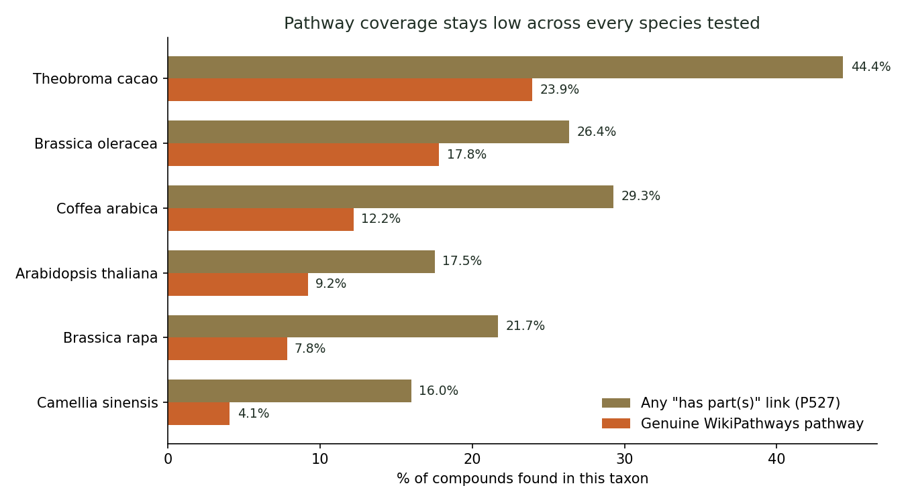
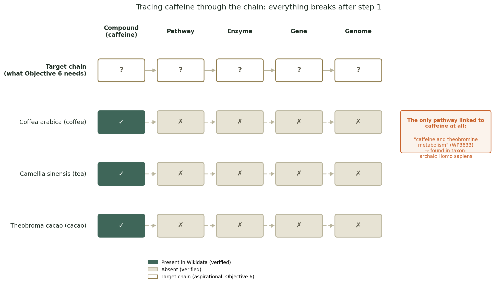

# Gap analysis

Working notes for Objectives 1 (domain survey) and 3 (gap & issue analysis).
Each entry records a concrete, re-run-able finding from the Wikidata Query
Service, not a general claim. Source queries live in [`../queries/`](../queries/).

## Coverage: compound -> pathway (Arabidopsis thaliana, Q158695)

Query: [`02_coverage_lotus_compound_to_pathway_gap.rq`](../queries/02_coverage_lotus_compound_to_pathway_gap.rq)
Run 2026-11-02.

| Metric | Count | % of total |
|---|---|---|
| Compounds found in taxon (P703) | 1284 | 100% |
| ...with *any* P527 ("has part(s)") backlink | 225 | 17.5% |
| ...with a backlink to a genuine WikiPathways-sourced pathway (P527 + P2410) | 118 | 9.2% |

**Reading:** even using the most generous existing property (P527, not a
dedicated compound->pathway property), over 90% of compounds known to occur
in Arabidopsis have no pathway context in Wikidata at all. This is the
baseline gap number for Objective 5's property-proposal justification.

## Coverage across species: is the gap Arabidopsis-specific?

Query: [`03_multispecies_compound_pathway_coverage.rq`](../queries/03_multispecies_compound_pathway_coverage.rq)
Run 2026-11-21. Same metric as above, run across six species chosen to
match the project's own motivating examples (coffee/tea/cacao for
caffeine, *Brassica* for a glucosinolate pilot candidate).

| Taxon | compounds | any P527 link | genuine pathway |
|---|---|---|---|
| Arabidopsis thaliana | 1284 | 225 (17.5%) | 118 (9.2%) |
| Brassica oleracea | 258 | 68 (26.4%) | 46 (17.8%) |
| Brassica rapa | 281 | 61 (21.7%) | 22 (7.8%) |
| Camellia sinensis (tea) | 713 | 114 (16.0%) | 29 (4.1%) |
| Coffea arabica (coffee) | 205 | 60 (29.3%) | 25 (12.2%) |
| Theobroma cacao (cacao) | 142 | 63 (44.4%) | 34 (23.9%) |

**Reading:** genuine-pathway coverage stays under 24% for every species
tested, and under 10% for half of them. The Arabidopsis number in the
previous section is not an outlier - this is a general gap, which
strengthens the case for a property proposal that isn't Arabidopsis-only.

*(Chart generated by [`notebooks/gap_visualizations.ipynb`](../notebooks/gap_visualizations.ipynb); re-run it to refresh against current data.)*

## Case study: caffeine in coffee, tea and cacao

Query: [`04_caffeine_case_study.rq`](../queries/04_caffeine_case_study.rq)
Run 2026-11-21. The project proposal's own motivating example is:
"Caffeine... evolved independently in coffee, tea and cacao using
different enzymes." This checks whether Wikidata actually has any data
reflecting that.

Every item linked to caffeine (Q60235) via P527 was pulled (~46 distinct
items). None of them is a plant-specific caffeine biosynthesis pathway.
Instead, they're a mix of: consumer drinks/products containing caffeine
(Red Bull, Diet Pepsi, tea itself as a drink, ...), drug combination
products (aspirin/caffeine/codeine, ...), and human
pharmacology/physiology pathways and activity terms (DNA damage response
WP707, purinergic signaling WP4900, taste-receptor-ligand entries for
TAS2R7/10/14/43/46). Exactly **one** genuine WikiPathways-sourced pathway
turns up: "caffeine and theobromine metabolism" (Q28869950, WP3633).
Checking its `found in taxon` qualifier shows it is tagged to
**Q15978631 = archaic Homo sapiens** - i.e. this is *human caffeine
catabolism* (via liver enzymes CYP2A6, CYP1A2, XDH, NAT2), not plant
*biosynthesis*, and not any of coffee, tea or cacao.

**Reading:** the project's headline motivating example isn't just
illustrative - it's empirically confirmed. Wikidata currently has **zero**
data distinguishing how coffee, tea and cacao each biosynthesize
caffeine, despite having compound, taxon, and even a (human-side)
metabolic pathway entity for caffeine itself.

*(Chart and category breakdown from [`notebooks/gap_visualizations.ipynb`](../notebooks/gap_visualizations.ipynb); the category for each item is a manual classification recorded in the notebook, not an automated inference.)*

The chart above shows *what kind of noise* fills the gap. The diagram
below traces caffeine through the actual chain, stage by stage, for the
three species that produce it - all independently re-verified live
(2026-11-21): caffeine is confirmed `found in taxon` for all three, and
every stage after that is confirmed absent for all three (queries 04, 06,
07, above).

*(Diagram from [`notebooks/gap_visualizations.ipynb`](../notebooks/gap_visualizations.ipynb).)*

## Qualifier usage: currently zero

Query: [`05_qualifier_usage_survey.rq`](../queries/05_qualifier_usage_survey.rq)
Run 2026-11-21. Objective 4 asks to "measure how widely these qualifiers
are used today" (P703, P927, P459, P659, P248 as qualifiers on the
compound-pathway/enzyme link). Checked every genuine P527 statement
between a genuine pathway and a compound found in one of the 6 species
from the coverage table above.

**Result: zero.** Not one of these statements carries *any* qualifier at
all, let alone the specific ones Objective 4 names.

**Reading:** the qualifier pattern isn't competing with inconsistent
existing usage - it would be the first qualifier usage on this part of
the graph at all. That's a cleaner, lower-risk starting point for the
modelling pattern (Objective 4/6): no existing qualifier conventions to
reconcile with or migrate away from.

## Gene -> genome coverage: empty beyond Arabidopsis, and empty there too

Query: [`06_gene_genome_coverage.rq`](../queries/06_gene_genome_coverage.rq)
Run 2026-11-21.

| Taxon | genes (instance of gene + found in taxon) | ...with genomic start+end (P644/P645) |
|---|---|---|
| Arabidopsis thaliana | 28 | 0 |
| Camellia sinensis (tea) | 0 | 0 |
| Coffea arabica (coffee) | 0 | 0 |
| Theobroma cacao (cacao) | 0 | 0 |
| Brassica oleracea | 0 | 0 |
| Brassica rapa | 0 | 0 |

**Reading:** confirms the project proposal's own claim - plant genes are
"sparse and mostly limited to *Arabidopsis thaliana*" - and goes further:
Arabidopsis's own 28 genes have **zero** genomic positions between them.
The gene -> genome leg isn't just rare for plants; in this sample it's
empty, full stop.

## Enzyme -> gene coverage: effectively empty too

Query: [`07_enzyme_gene_coverage.rq`](../queries/07_enzyme_gene_coverage.rq)
Run 2026-11-21. Within the genuine pathways reachable from compounds found
in the 6 species, how many P527 parts are actually typed as an enzyme
(Q8047), and do they have an `encoded by` (P702) gene?

Across all six species combined: only 3 genuine pathways contain *any*
enzyme-typed item, and there is exactly **one** distinct enzyme-typed item
in total - "M-phase inducer phosphatase" (Q3775177), a human cell-cycle
enzyme with no connection to plant biosynthesis - and it has **zero**
P702 gene link.

**Reading:** combined with the earlier finding that pathway-linked "genes"
are typically reached directly via P527 (not through a distinct enzyme
entity), this suggests the `pathway -P527-> enzyme -P702-> gene` chain the
project describes mostly doesn't exist as data yet; what little gene data
there is sits one hop closer (`pathway -P527-> gene` directly), still with
no taxon qualification (see above).

## Modelling issue: P527 ("has part(s)") is overloaded

Query: [`01_arabidopsis_lotus_pathway_gene.rq`](../queries/01_arabidopsis_lotus_pathway_gene.rq)

Dropping the P2410 filter and querying P527 backlinks on a compound returns
a mix of:
- genuine metabolic pathways (e.g. *TCA cycle*, Q27436670)
- plain composition/part-whole statements with no biosynthetic meaning at
  all (e.g. *ammonia* is "part of" *ammonium cation*, *ammonia solution*,
  *metal ammine complex*)

P527 is being used both for "this pathway has this metabolite as a step"
and for ordinary chemical part-whole relationships. Any coverage query or
modelling pattern that uses P527 as the compound->pathway link needs the
P2410 (WikiPathways ID) guard (or an equivalent instance-of-pathway check)
to avoid counting noise as coverage.

## Modelling issue: natural product class hierarchy is inconsistent

*Ammonia* (Q4087), a compound returned by a plain `found in taxon` query,
is `instance of` "type of chemical entity" (Q113145171) - not "chemical
compound" (Q11173) or any single consistent compound class. A query or
pattern that assumes a uniform `P31` value for LOTUS-sourced compounds will
silently drop rows. Needs a wider survey across more taxa to see how
widespread this is (candidate for Objective 1).

## Modelling issue: pathway data is not taxon-specific

For the genuine WikiPathways pathways linked to Arabidopsis compounds
(e.g. WP78 "TCA cycle", WP497 "urea cycle and metabolism of amino groups",
WP716 "Vitamin A and carotenoid metabolism"), the genes attached via P527
are human gene symbols (SUCLA2, SDHA, OGDH, SDHB, SDHC, SDHD, DLD, DLST,
IDH2/3A/3B/3G, MDH2, FH, CS, ACO2, SUCLG1/2, ...), not Arabidopsis genes.

Restricting the gene side of the query to genes with `found in taxon`
(P703) = Arabidopsis thaliana returns **zero rows** (confirmed by running
query 01 - 200/200 result rows, 0 with `?gene` bound).

**Reading:** this is a direct, queryable demonstration of the project's
central motivation. A compound's "found in taxon" link and a pathway's
"has part" link to a gene currently compose into a false implication -
that this plant's biosynthesis uses that (human) gene - because neither
link carries taxon-qualification on the pathway/gene side. This is exactly
the gap the qualifier pattern (Objective 4) and the caffeine example on
the project page are about: biosynthesis is taxon-specific, and Wikidata's
current pathway/gene data mostly isn't.

## Modelling issue: two incompatible pathway conventions, and an unused class that would fix it

Checked 2026-11-21, prompted while picking a pilot example for the
modelling pattern (Objective 6). Wikidata currently has two different,
non-interoperable ways of representing "pathway-like" things:

1. **WikiPathways-style pathways** (what queries 02-07 use): `instance of`
   "biological pathway" (Q4915012), carry a WikiPathways ID (P2410), and
   list reaction participants via `has part(s)` (P527). This is what TCA
   cycle, the caffeine/theobromine metabolism pathway, etc. use.
2. **Gene Ontology process terms**: e.g. "glucosinolate biosynthetic
   process" (Q22274797, imported from GO:0019761) is `instance of`
   "biological process" - a completely different class - and reached via
   `subclass of` hierarchies, not WikiPathways IDs. It does use `has
   part(s)` (P527) to list the compound (glucosinolate), but has no genes,
   no enzymes, and no taxon - it is a generic, organism-independent
   process description.

These two conventions don't share a type, so a SPARQL query (like ours)
written for one silently misses the other. For *A. thaliana*'s own
glucosinolates specifically, the only pathway-shaped entity Wikidata has
is the GO-style process term, not a WikiPathways-style one.

**A usable fix already exists in the ontology and is unused:**
"biosynthetic pathway" (Q70696303) is `subclass of` both "biological
pathway" and "metabolic pathway" - exactly the right place in the
hierarchy for this project's domain - but **zero items** use it
(`?item wdt:P31 wd:Q70696303` returns 0 rows). Every real pathway item
just uses the generic parent "biological pathway" directly. This is a
concrete, low-effort fix: new biosynthesis-pathway items created under
Objective 6's pilot should be typed `instance of biosynthetic pathway`
(Q70696303) specifically, not the generic class - which would also, for
the first time, make "give me biosynthetic pathways specifically" a
answerable SPARQL question instead of requiring the P2410 workaround.

(Side finding: `?pathway wdt:P31 wd:Q4915012 ; wdt:P527 ?compound` returns
almost the same compound set as the P2410-based filter used in queries
02-07 - 193 vs 190 compounds, 190 overlapping, across the 6 species - so
`instance of biological pathway` is at least as reliable a "genuine
pathway" filter as the WikiPathways-ID heuristic, and more semantically
direct. Worth switching to as the primary filter in any future query.)

## Connections to the Ontology Course material

The course's own weekly slides (`slides_course/`) turn out to cover several
of these issues directly - worth citing rather than treating our findings
as isolated observations. (Checked 2026-11-21.)

- **Instance-of vs subclass-of (Weeks 1-2).** The course calls this "the
  most important thing" not to mix up. Our "ammonia is inconsistently
  typed" finding (above) and the pathway class-order question (is a
  pathway a class or an individual process?) are direct instances of this.
- **Chemistry-as-a-class discussion (Week 1, "Aldol" example) and the
  chemistry WikiProject's 2024 instance->subclass migration (Week 5).**
  The course material explicitly documents that chemistry/gene/protein
  class modelling is "still messed up" even after a deliberate fix
  attempt. This is direct precedent: our compound-typing and gene/enzyme
  modelling issues are a known, acknowledged class of problem, not
  something specific to LOTUS data.
- **Gene-domain instance/subclass and disjointness fixes (Week 4, Week 6).**
  The course's own gene-domain case study ("gene was subclass of nucleic
  acid sequence", later fixed) is structurally the same kind of issue as
  what we'd expect to find once we survey plant gene modelling in depth
  (Objective 1, still to do for the gene/genome leg of the chain).
- **Constraints are advisory, not enforced (Week 3).** This is the
  argument for why a SPARQL-based gap analysis is necessary in the first
  place: Wikidata's constraint system would not have caught any of the
  issues documented here (missing qualifiers, P527 overloading,
  non-taxon-specific pathway data).
- **Mereology / "has part" (P527) flagged as unfinished future work
  (Week 7).** The course explicitly lists "part-of in Wikidata... done,
  but more work remains" as an open problem. Our P527-overloading finding
  (above, and the caffeine case study) is a concrete instance of exactly
  that open problem, in the biosynthesis domain specifically.
- **Problem taxonomy + "culprit" statistics methodology (Week 6).** The
  course's own gap-analysis method - count violations via SPARQL,
  classify them into named problem categories, quantify before/after a
  fix - is the same method this gap analysis is already using. Worth
  explicitly classifying each finding here against that taxonomy (e.g.
  P527 overload = "overloaded/ambiguous property use"; the caffeine case
  = "loss of context from unqualified statements") when writing up
  Objective 3 formally.
- **Property-proposal workflow (Week 2) and post-course venues (Week 8:
  WikiProject Ontology, the Ontology Cleaning Task Force, the proposed
  Data Organization & Quality User Group).** Direct procedural reference
  for Objective 5 and for where to take the LOTUS external-ID proposal
  for review and after the course ends.

## Property proposal candidate: LOTUS ID doesn't work, PlantMetWiki ID does

Checked 2026-11-21, while scoping Objective 5's property proposal (the
course reviewer suggested starting with a LOTUS external-ID property,
since external identifiers are easier to get approved than relational
properties).

**LOTUS does not have its own external identifier to propose a property
for.** LOTUS describes itself as doing "knowledge management *through*
Wikidata" - its structure-organism pair data lives directly in Wikidata
as `found in taxon` (P703) statements referenced to source literature,
not in a separate database with its own stable per-record IDs. A "LOTUS
ID" property would have nothing external to point to.

**PlantMetWiki does work**, and is already one of Objective 5's own listed
candidates. Queried its live SPARQL endpoint
(plantmetwiki.bioinformatics.nl) directly:
- 1,162 pathway items use a stable `PC<number>` identifier (e.g. `PC1001`
  = "nicotine biosynthesis", a real plant biosynthesis pathway) - this
  number matches the 1,162 plant metabolic pathways figure from the
  PlantMetWiki preprint itself.
- A separate 1,316 items use an `RC<number>` identifier (not used for the
  property proposal below - likely a reaction/sub-pathway grouping, not
  confirmed).
- `https://plantmetwiki.bioinformatics.nl/pathways/PC1000` resolves (HTTP
  303 to a live SPARQL-backed record view) - confirming `PC<number>` is
  the stable, resolvable identifier, not an artifact of one RDF release.
- Checked Wikidata for an existing "PlantMetWiki" or "PlantCyc" property:
  none exists.

See [`proposals/pathway-representation-proposal.md`](../proposals/pathway-representation-proposal.md)
for the full reflection this fed into - framed around representing the
whole chain, not just this one identifier, and explicitly not submitted
or implemented (project decision).

## Pilot, Phase 1: the pattern tested in practice

The modelling pattern's role-qualifier option (above and in
[`proposals/modelling-pattern.md`](../proposals/modelling-pattern.md))
has since been implemented on one real item:
[caffeine biosynthesis (Q142235637)](https://www.wikidata.org/wiki/Q142235637),
created and verified 2026-11-21. It carries `instance of` "biosynthetic
pathway" (Q70696303) and four `has part(s)` statements (xanthosine ->
7-methylxanthine -> theobromine -> caffeine), each qualified with
`object of statement has role` (reaction intermediate / product) and
referenced to a general caffeine-biosynthesis mechanism paper -
deliberately with no taxon qualifier yet, since the compound route itself
doesn't differ between species (see the modelling pattern document for
why, and for the Phase 2 enzyme/gene work this doesn't yet cover).

## Still open / not yet checked

- `stated in` (P248) does **not** point to Q104225190 ("LOTUS, natural
  product database") on any P703 statement, and `based on heuristic`
  (P887) doesn't either (both checked, 0 results). There is currently no
  found way to query "which P703 statements came specifically from the
  LOTUS import" versus any other source of the same property. Revisit
  during the full domain survey (Objective 1) - may need to check edit
  history / dump metadata rather than live statement RDF.
- Crosswalk to PlantMetWiki, ChEBI, Plant Ontology, Rhea, EC (Objective 2) -
  not started.
- Federated queries against PlantMetWiki/WikiPathways (as opposed to just
  querying Wikidata's local copies of WikiPathways IDs) - not started.
- The full chain (compound -> pathway -> enzyme -> gene -> genome) has now
  been measured end to end across 6 species (queries 02-07, above). The
  remaining open piece of Objective 1/3 is breadth, not depth: everything
  so far covers 6 species chosen for their relevance to the project's own
  examples, not a random or representative sample.
